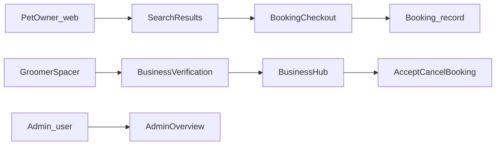

# Fursgo — Project Flow

## Product

Pet grooming marketplace (UK-oriented):

- **Pet owners** (`web` guard / `User`) search and book groomers or spaces, manage pets/profile/settings.
- **Providers** (`groomer_spacer` guard / `GroomerSpacerProfile`) complete business verification, then run **Business Hub** + **Marketing Hub**.
- **Admins** (`User` with `user_type=admin`) use `/admin`.

## Stack & runh

| Item        | Detail                                                          |
| ----------- | --------------------------------------------------------------- |
| Framework   | Laravel 12, PHP ^8.2                                            |
| UI          | Livewire Volt + Flux; Blade under `resources/views/`            |
| PDF         | `barryvdh/laravel-dompdf`                                       |
| Tests       | Pest                                                            |
| Run         | `composer run dev` → `php artisan serve --no-reload`            |
| Local reset | Non-prod only: `GET /seed` (migrate:fresh --seed), `GET /clear` |

## Directory map

| Path                          | Purpose                                                                               |
| ----------------------------- | ------------------------------------------------------------------------------------- |
| `routes/web.php`              | Public + authenticated app routes                                                     |
| `routes/auth.php`             | Login/signup/verification (owner + groomer/space)                                     |
| `routes/admin.php`            | `/admin` Volt routes                                                                  |
| `app/Models/`                 | Eloquent models                                                                       |
| `app/Http/Controllers/`       | Bookings, pets, search, PDFs, exports                                                 |
| `app/Http/Middleware/`        | Auth guards, business page shells, login session tracking                             |
| `app/Support/`                | `VoltPage`, `BusinessHubNav`, `MarketingHubNav`, `BusinessPageShell`, decline reasons |
| `app/Livewire/`               | Sparse (e.g. `Actions/Logout`); most UI is Volt                                       |
| `resources/views/livewire/`   | Volt page components (primary UI)                                                     |
| `resources/views/components/` | Blade UI (business-hub, admin, shared)                                                |
| `database/migrations/`        | Schema                                                                                |
| `database/seeders/`           | Including `DevUserSeeder`, `HomepageContentSeeder`                                    |
| `public/`                     | CSS, images, fonts, icons                                                             |

Pages render via `app/Support/VoltPage.php` → Volt name maps to `resources/views/livewire/{dot.path}.blade.php`.

## Auth & roles

**Guards** (`config/auth.php`):

| Guard            | Provider / model       | Use                        |
| ---------------- | ---------------------- | -------------------------- |
| `web`            | `User`                 | Pet owners (+ admin users) |
| `groomer_spacer` | `GroomerSpacerProfile` | Groomers / space owners    |

**Middleware aliases** (`bootstrap/app.php`):

- `auth.admin` → `EnsureAdminAuthenticated`
- `auth.groomer_spacer` → `EnsureGroomerSpacerAuthenticated`
- `auth.web_or_groomer_spacer` → `EnsureWebOrGroomerSpacerAuthenticated`
- `business.shell.web` / `business.shell.business-hub` → header shell variants

**Web append middleware:** `TrackAccountLoginSession`, `ApplyBusinessPageShellFromRequest`.

**Role signals:**

- Admin: `User::isAdmin()` → `user_type === 'admin'`; also `user_status === 'active'`.
- Provider types on profile: `GroomerSpacerProfile.user_type` (e.g. groomer vs `space`).
- DB table / FK spelling: `goormer_spacer_profiles`, often `goormer_spacer_id`.

## Route map (by actor)

### Public

| Route                                                 | Volt / view                                                                            | Name                                    |
| ----------------------------------------------------- | -------------------------------------------------------------------------------------- | --------------------------------------- |
| `/`                                                   | `home` (Volt + `HomepageContent::customer()`)                                          | `home`                                  |
| `/business-landing-page`                              | static blade                                                                           | `business-landing-page`                 |
| `/business-homepage-groomer-space-owner`              | `business.homepage` or hub shell variant                                               | `business-homepage-groomer-space-owner` |
| `/search-results`                                     | `search.results`                                                                       | `search-results`                        |
| `/support-and-assistance/search`                      | `help.search`                                                                          | `search`                                |
| `/support-and-assistance/help-and-support`            | legacy static help                                                                     | `help-and-support`                      |
| Checkout shells                                       | `checkout.booking-groomer`, `checkout.booking-space`, `checkout.booking-groomer-space` | `checkout.*`                            |
| Groomer/space unavailability URLs                     | `groomer.unavailability` / `space.unavailability`                                      | various                                 |
| Overlay demos                                         | cookies / rating blade files                                                           | cookies*, rating*                       |
| 404                                                   | `resources/views/errors/404.blade.php` (business public chrome)                        | —                                       |
| `/messages_notification/messages.php` (+ `/messages`) | Imported static Messages (`messages_notification.messages-legacy`)                     | `messages_notification.messages*`       |
| `/profiles/groomer/groomer_profile.php` (+ no `.php`) | Imported static Groomer Profile (`profiles.groomer-profile-legacy`)                  | `profiles.groomer*`                     |
| `/profiles/space/space_profile.php` (+ no `.php`)     | Imported static Space Profile (`profiles.space-profile-legacy`)                        | `profiles.space*`                       |

### Pet owner (`web` or web-or-groomer middleware)

| Route                                                | Notes                                                   |
| ---------------------------------------------------- | ------------------------------------------------------- |
| `/login`, `/signup` (+ `login-signup/*` aliases)     | Volt auth                                               |
| `/login-signup/setup_owner_account*`                 | Owner onboarding                                        |
| `/booking-groomer`                                   | Booking UI                                              |
| `/my-account/pet-owner-profile`, `/settings/profile` | Profile                                                 |
| `/account-settings` (+ download-data)                | Settings; redirect from `/account-and-setting/settings` |
| `/pet-details` GET/POST                              | Volt manager + `PetDetailController@store`              |
| `/bookings` CRUD + accept/cancel                     | `BookingController`                                     |

### Provider (`groomer_spacer`)

| Route                                                 | Notes                                                                                   |
| ----------------------------------------------------- | --------------------------------------------------------------------------------------- |
| `/login-groomer-space`, `/signup-groomer-space`       | Always reachable (not behind `guest`; already-authed groomer redirects in page `mount`) |
| `/business-verification` (+ PDF/private files)        | Onboarding                                                                              |
| `/business-hub`                                       | Main provider app (session nav)                                                         |
| `POST /business-hub/nav`, `POST /business-hub/switch` | Nav persist / multi-profile switch (same email)                                         |
| `/marketing-hub` + `POST /marketing-hub/nav`          | Marketing                                                                               |
| Invoice PDF/HTML                                      | `business-hub/bookings/{booking}/invoice.pdf`                                           |

### Admin

| Route                                 | Notes                                                      |
| ------------------------------------- | ---------------------------------------------------------- |
| `/admin/login`                        | Volt `admin.auth.login`                                    |
| `/admin`                              | Volt `admin.overview` (tabbed Alpine UI)                   |
| `POST /admin/homepage-content/{section}` | Save Customer Homepage CMS section (`HomepageContentController`) |

Auth routes: `routes/auth.php`. Admin: `routes/admin.php`.

## Core entities

| Model                                                               | Role                                                                                                               |
| ------------------------------------------------------------------- | ------------------------------------------------------------------------------------------------------------------ |
| `User`                                                              | Pet owner / admin; pets, bookings as owner                                                                         |
| `GroomerSpacerProfile`                                              | Provider account (JSON business profiles, payout, verification flags)                                              |
| `Groomer` / `Space`                                                 | Provider-side profiles linked historically to users                                                                |
| `Booking`                                                           | `pet_owner_id`, `goormer_spacer_id`, date/time, service, amount, status, add-ons, staff, refunds, marketing fields |
| `PetDetail` + `PetMedicationDetail`                                 | Owner pets; M2M `booking_pet`                                                                                      |
| `Service`, `AddOn`, `ServiceArea`, `ServicePolicy`, `PetPreference` | Provider catalog / policies                                                                                        |
| `Staff`                                                             | Provider staff calendar                                                                                            |
| `Payment`, `PromoCode`, `PromoCodeUsage`                            | Money / discounts                                                                                                  |
| `Review`                                                            | Post-booking ratings                                                                                               |
| `SupportTicket` (+ attachments), `FaqCategory`, `FaqArticle`        | Help                                                                                                               |
| `HomepageSetting`, `HomepageItem`                                   | Customer Homepage CMS (`homepage_settings` + `homepage_items`); loader `App\Support\HomepageContent`               |
| `AccountSetting`, `AccountLoginSession`, `AccountBlock`             | Account security / prefs                                                                                           |

**Booking statuses:** `pending` → `confirmed` → `completed`; or `cancelled` (`cancelled_by`, `cancellation_reason`, refund fields).

## Main flows

**Owner:** signup → optional `login-signup` owner setup → add pets (`/pet-details`) → search → booking/checkout → `/bookings` lifecycle.

**Provider:** signup-groomer-space → business-verification (ID, business profile, legal, status) → `/business-hub` (services, availability, bookings, clients, earnings, settings) → optional `/marketing-hub`.

**Booking ops:** create via UI / `BookingController@store`; provider accept/cancel patches; invoice PDF from hub.

## Business Hub / Marketing Hub

Single Volt pages; section state in session (not separate routes).

**BusinessHubNav** (`app/Support/BusinessHubNav.php`):

- Sections: `business-hub`, `bookings`, `availability`, `manage-availability`, `services`, `clients`, `earnings`, `settings`
- Manage Availability (`manage-availability.blade.php`, Figma 443:899 / 447:123 / 450:1415 / 448:861 / 450:1821): list landing (Core Business card + Team members + **Add Member**) → schedule edit (Back to All availability, staff strip, pause banner, Work Week Hours, Business time off + dashed Add / modal, sticky save bar). Away = `pause_booking`; Add Team Member modal includes email; status pills Active `#afcd6f` / Away `#f9c45c`.
- Booking filters: `pending` | `confirmed` | `completed` | `cancelled`
- Bookings list: unified cards (date block · avatar · Booking ID / Service Type / Pet · Owner|Client · status + price); pending rows show timer + Decline/Accept and `-----` ID; confirmed/completed/cancelled rows show client-tier chip beside Owner/Client with status + price flush right; `bookings.auto_accepted` shows a green bolt beside the Confirmed chip; on All Bookings with no service filter, pending rows sort first then Soonest first; Filter checklist + chips; Sort (Soonest first / Highest·Lowest Value / Client A–Z); Auto-accept toggle (`goormer_spacer_profiles.auto_accept_booking`) — ON uses green `#8BAE40`
- Space Host bookings copy: Client (not Owner); Booking IDs `SH-#####` (groomer `FG-#####`); Service Type Full-Day / Half-Day / Hourly; Pet column shows pets (or `-----` when pending with none); row avatar uses client photo; accent `#FFA899`
- Overview dashboard: welcome + date + Manage availability; metric cards (Earned today / Next appointment / New review); Today’s schedule + Weekly revenue (Mon–Sun) + Pending Requests; groomer `#FFC97A` / space `#FFA899` visit badges
- Availability (`availability.blade.php`): full-width Day/Week/Month calendar (no side mini-cal / preview). Stats row card (border `#e2e2e2`) — Confirmed `#92b842` / Completed `#7AB7E3` / Pending `#FFAE37` counts react to the visible month, Next free slot `Tue 7 Feb · 08:30 (8h)` from today forward (Playfair). Month cells (~115px) show date + `X booked · Yh free` (or `Time off`) + layered pastel capacity pills (`#CBDCE8`/`#D8E8B7`/`#FFC97A` on `#EFEFEF`); today uses accent circle + border (groomer `#FFC97A`/`#FFFBF4`, space `#FFA899`/`#FFF7F5`). Clicking a month cell opens the day bookings drawer (Figma 437:1047 / 437:1815): Playfair date title + `X booked ·` / green `Yh free`; timeline rows = start time + `N min` · status rail · status/visit pills · service (+Add-ons) · pet · client; free-window pill in-list; empty = calendar icon + “No bookings this day” / “Your full Xh day is open.”; footer dark **Manage Availability**. Booking click opens shared `booking-details-drawer` (confirmed/pending/completed footers; Back to date when opened from a day); day-list and details drawers are mutually exclusive (opening one closes the other; Back restores the day list via `detailsBackDateKey`). Week/Day views share Figma’s 10×55px body (top spacer + last muted band; cream `#F9F8F4` gutter): week labels `8am`…`16pm` (one row/hour); day labels `8am`…`12pm` only (two rows/hour). Week = 7 day columns with 2px-inset selected-body outline + left status accent on events; day = header `Wed` + `15 February`, near full-bleed `rx=5` event cards with inset 6px top accent (`#CBDCE8`/`#D8E8B7`/`#FFC97A`, fills `#F5F8FA`/`#F4F8EC`/`#FFF6E9`; space pending `#FFA899`). Time-off: inset block `All Day · Time Off` + `Other` (`#9D9B98`). Stats pills switch to `This week` (week-range counts) outside Month view. Server enriches `window.__availabilityCalendar.byId` with `durationMinutes`, `spaceKind`, `spaceKindHoursLabel`, `spaceDurationIcon`, `providerSpaceType`; cancelled bookings never count toward capacity. Dev seed: `BookingSeeder::seedAvailabilityCalendarDesign` + `StaffSeeder` holidays for current-month capacity/time-off on `groomer@dev.com` / `space@dev.com` (`acquisition_source=availability_design`).
- Booking row click opens right-side Booking details drawer (`booking-details-drawer`) for pending / confirmed / completed / cancelled (status chip, Owner|Client + tier, appointment grid — Location vs Space for hosts, pets shown for both, service & add-ons + earn/payout box, status-specific footer; space confirmed footer omits Directions); Pending “View details” on overview still opens Booking Request modal (`pending-request-modal`); Accept → Booking Confirmed modal; Decline → Cancel Booking Request modal (reason + Keep request/Decline; space summary = Service/Date/Time/Client/Payment); Reschedule modal proposes new date/time cards (space accent `#FFA899`, Full-Day/Half-Day/Hourly copy)
- Profile switcher: checkmark on active business; yellow `#fffbf4` highlight is hover/focus only
- Avatar placeholders (no photo / broken image): initials via `App\Support\BusinessHubAvatar` / `x-business-hub.common.avatar` + `window.bhAvatarFallback`; text `#FDFDFD` Lato 800; bg groomer `#FFC97A`, space `#FFA899` (`--bh-avatar-bg` / `--bh-avatar-ring`). Photo available: white circle ring with same accent stroke.
- Service menus: `services`, `add-ons`, `pet-preferences`, `service-area`
- Earnings menus: `overview`, `transactions`, `pay-outs`, `invoices`
- Settings menus: `general`, `business-details`, `service-policies`

**MarketingHubNav:** parallel session nav for marketing hub Volt. Overview matches the hub frames: period tabs, KPI cards, tip, peak booking times, top promo, and the acquisition bar. Groomers show service + pet donuts (sidebar/header accent `#FFC97A`). Space hosts show rental types (Full Day / Half-day / Hourly) and add-ons (Lockers / After-hours Access / Deep Clean) with accent `#FFA899`.

**Shells:** `SetBusinessPageWebShell` vs `SetBusinessPageBusinessHubShell` / `BusinessPageShell::resolveComponent(...)` for shared pages with dual chrome.

Volt entry: `resources/views/livewire/business-hub.blade.php`, nested under `livewire/business-hub/**`.

## Admin

- Login: `/admin/login`; middleware `auth.admin`.
- Overview: `/admin` with Alpine tabs — components under `resources/views/components/admin/` and `resources/views/admin/tabs/`.
- Website Content tab: subnav (Homepage & Marketing · Static Pages · Help Centre · Legal & Policy Documents · Global Footer). **Customer Homepage** is DB-backed (`homepage_settings` + `homepage_items`): admin Alpine loads via `HomepageContent::adminBootstrap()`, saves via `POST /admin/homepage-content/{section}`; public `/` renders the same data. Sections: Hero (+ rating strip), Feature Highlight, How it works, Popular Services, Testimonials, Our Mission, Service Map. Seed: `HomepageContentSeeder` (skips if settings already exist). Groomers & Hosts / Business Homepage targets and other subnav panels remain placeholders.
- Business provider detail tabs: Overview, Profile (public profile / gallery / business details / notes / activity + Services · Policies · Reviews subnav; dual Groomer/Space Host via sidebar `viewAs` — space subnav active `#FFA899`, active status pills `#EAF3DE`/`#A7C569`), Activity, Account, Compliance, Support (ticket list → detail with submission / limited thread / linked states: populated · empty · na · suggested / shared admin notes / details+activity; no modals; sidebar stays default provider actions), Payouts (Earnings overview dual groomer/space — space accents `#FFA899` on subnav/chart/progress, space booking Full-Day·Half-Day·Hourly + bank settings; Transactions expandable cards; Payouts list; Invoices → payment-detail); Bookings (subnav Bookings · Availability · Clients — Bookings: metric cards + status filters + table Owner/Pet · Service/Location · Date/Time + export; row/eye opens booking detail with summary card · details · price breakdown · activity timeline; Availability: day schedule + calendar · working week hours · time off · booking intake status · activity timeline; Clients: table with avatar/initials · bookings · paid · last booked + export/pagination; eye opens client profile modal — stats · recent bookings · recent review + view full customer profile).
- Pet owner detail tabs: overview, pets, bookings, payments (list + detail by status), support (ticket list → detail with submission / linked records + Add link / Mark as resolved / Open dispute (+ success) / Merge / Reassign / Close ticket modals / thread / notes / details+activity; sidebar switches list actions ↔ ticket actions), referrals, activity — under `resources/views/components/admin/customer/`.

## Codebase notes

- Primary UI lives in Volt under `resources/views/livewire/`.
- `web.php` keeps underscore/hyphen URL aliases and redirects for legacy parity.
- Help & Support serves legacy static views; older Volt help components remain (see comments in `web.php`).
- Messages serves imported static view from `D:\fursgo\messages_notification` (`messages.css` + `messages-page.js`); aliases keep `/messages_notification/messages` links working.
- Groomer/Space Profiles serve imported static views from `D:\fursgo\profiles` (`groomer_space_profile.css`, `choose_partner_modal.css`, `profile.js` + Leaflet/CARTO); `body_class` via `layouts.app`.
- GET requests to Livewire `/update` paths redirect to referer (`bootstrap/app.php` exception handler).
- Profile switch (`business-hub/switch`) only allows profiles with the same email.
- Controllers: `BookingController`, `PetDetailController`, `SearchController`, `BookingInvoicePdfController`, `AccountDataExportController`, `LegalAgreementsPdfController`, `GroomerSpacerPrivateFileController`.
